## {#title .unnumbered .unlisted data-state="hide-footer"}

::: {.title-grid}
::: {}
<h1>From Diverse Paths to a Common Core<span class="sub">Kickstarting a Bioimage Analysis Curriculum</span></h1>

<div class="who">Agustín Corbat</div>
<div class="where">Facultad de Ciencias Exactas y Naturales · Universidad de Buenos Aires</div>
<div class="where">GloBIAS Annual Meeting · November 2026</div>

<div class="contact">acorbat@df.uba.ar · <a href="https://bsky.app/profile/acorbat.bsky.social">@acorbat.bsky.social</a></div>
:::
::: {}
{fig-alt="Folded map of an archipelago with three islands: computing (red), biology (teal) and optics (yellow), with sailboats travelling between them."}
:::
:::

<div class="logos-corner left">


</div>
<div class="logos-corner right">
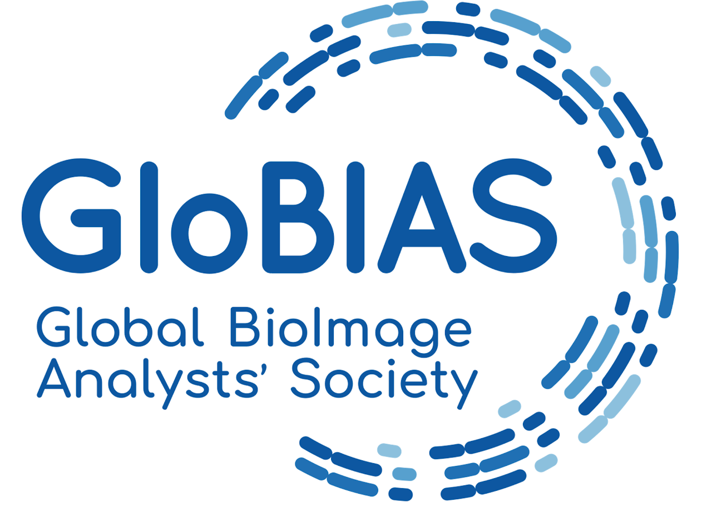

</div>

::: {.notes}
**0:00 → 0:30.** Hi, I'm Agustín. This talk is half proposal, half invitation. By the end I'll ask you to help start a Working Group.
:::

# Diverse paths {background-color="#F6F6F4"}

## Which island did you sail from? {.center-h}

::: {.columns}
::: {.column width="64%"}
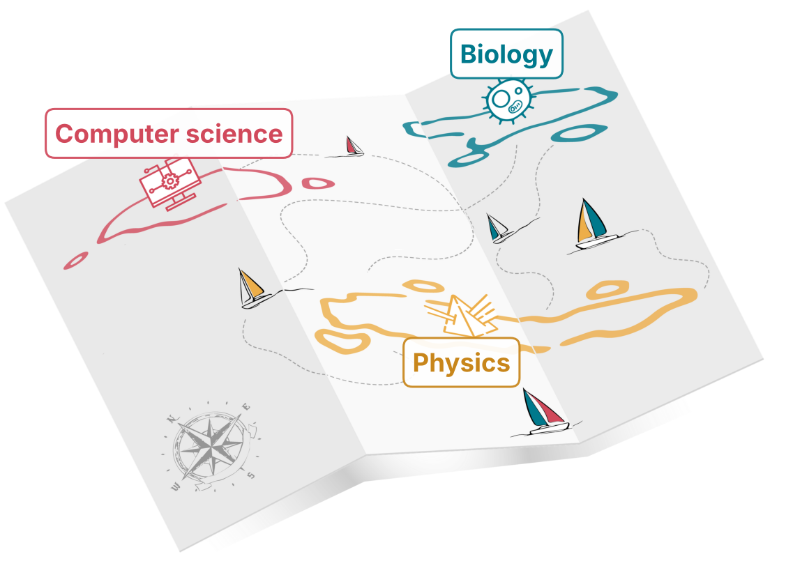{fig-alt="The archipelago map with labels: Computer science, Biology, Physics."}
:::
::: {.column width="36%"}
<br>

[Raise your hand:]{.muted}

::: {.incremental}
- [Biology]{.teal}
- [Physics]{.yellow}
- [Computer science]{.red}
- Engineering, chemistry, medicine…
:::

::: {.fragment}
**The room *is* the problem statement.**
:::
:::
:::

::: {.notes}
**0:30 → 1:30.** Show of hands, one per island. Look around: we all do "bioimage analysis", but we arrived from very different places. Different maps, different blind spots.
:::

## Many islands, one profession — and every island has blind spots

::: {.columns}
::: {.column width="40%"}
> Scientists performing bioimage analysis have a diverse background and need to acquire a theoretical foundation on image formation as well as image processing and analysis algorithms.
> <span class="src">Tischer et al., J. Microsc. 2026</span>

::: {.small}
There is no BIA degree: we arrive through PhDs, facilities, and self-teaching.
:::
:::
::: {.column width="60%"}
<table class="matrix">
<tr><th></th><th>Digital images</th><th>Image generation</th><th>Programming</th><th>Biological context</th></tr>
<tr><th class="row teal">Biology</th><td class="lo">gap</td><td class="lo">gap</td><td class="lo">gap</td><td class="hi">strong</td></tr>
<tr><th class="row yellow">Physics</th><td class="mid">some</td><td class="hi">strong</td><td class="mid">some</td><td class="lo">gap</td></tr>
<tr><th class="row red">Computer sci.</th><td class="mid">some</td><td class="lo">gap</td><td class="hi">strong</td><td class="lo">gap</td></tr>
</table>

[Typical prior knowledge (illustrative; adapted from the background annotations in `bia_curriculum`).]{.xsmall .muted}
:::
:::

::: {.notes}
**1:30 → 2:45.** Nobody gets a degree in bioimage analysis. Each background brings strengths and gaps. The diagonal is strong, and the rest is often learned on the job, if at all. The trouble is that we rarely know which gaps we have.
:::

## Same pipeline, silently wrong

::: {.columns}
::: {.column width="33%" .fragment}
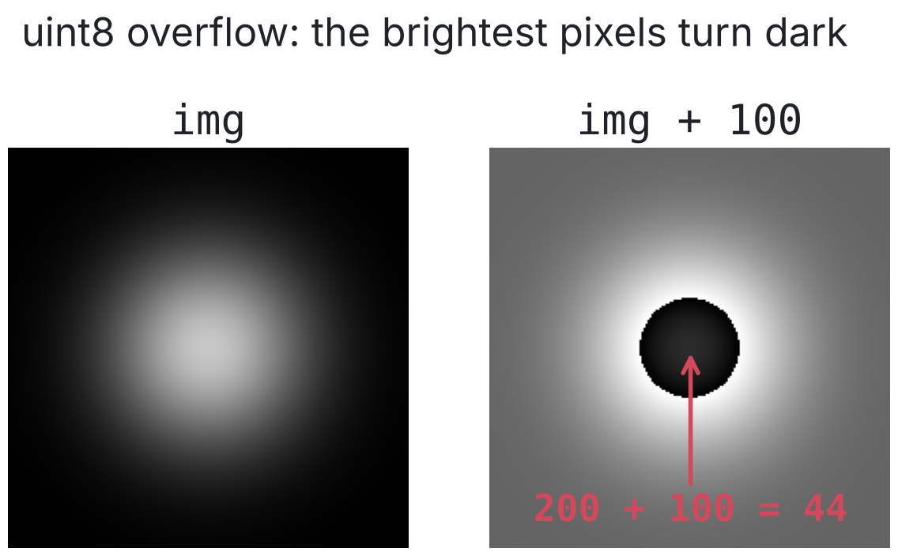{fig-alt="A bright blob plus 100 in uint8 wraps around so the centre becomes dark: 200 + 100 = 44."}
:::
::: {.column width="33%" .fragment}
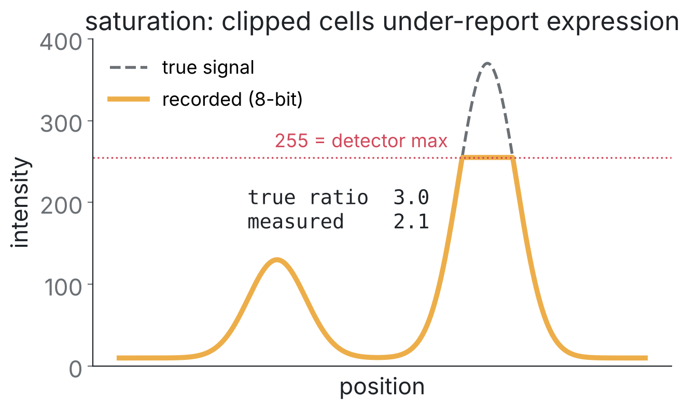{fig-alt="Line profile of two cells; the brighter one is clipped at 255 so the measured ratio is 2.1 instead of 3.0."}
:::
::: {.column width="33%" .fragment}
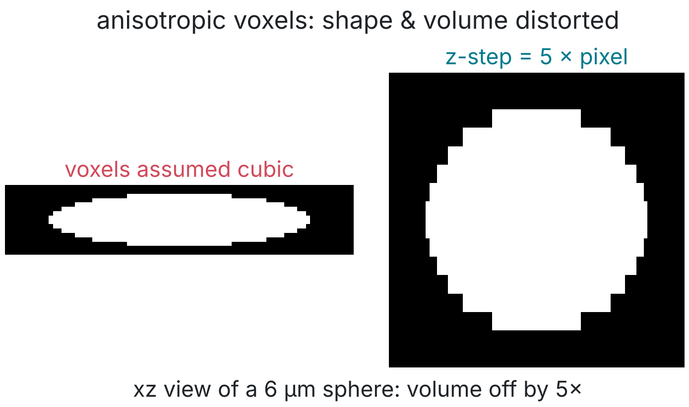{fig-alt="xz view of a 6 micrometre sphere displayed with cubic voxels appears 5 times flatter than the calibrated view."}
:::
:::

::: {.fragment .center}
<br>**Each of these is obvious to someone from another island.**
:::

::: {.notes}
**2:45 → 4:15.** Three bugs that produce numbers, not errors.
(1) uint8 arithmetic in NumPy: 200 + 100 = 44 (it wraps around). A programmer spots it immediately; a biologist may not. (Fiji's 8-bit maths clips at 255 instead: a different silent error.)
(2) Saturation: clipped cells under-report expression. The true ratio is 3 and we measure 2.1.
(3) Anisotropic voxels: forget the z-step and your sphere becomes a pancake, with volume off by 5×.
None of these crash. They just give you wrong biology.
:::

# What already exists {background-color="#F6F6F4"}

## We are not starting from zero

::: {.cards .three}
::: {.card .grey}
[Books & lessons]{.ct}
Bankhead, *Introduction to Bioimage Analysis*<br>
Carpentries, *Image Processing with Python*
:::
::: {.card .grey}
[Courses & MOOCs]{.ct}
EPFLx, *Image Processing and Analysis for Life Scientists*<br>
Haase, *BioImage Analysis* lectures<br>
ZIDAS · NEUBIAS Academy
:::
::: {.card .teal .fill-teal}
[Modular training resources]{.ct}
NEUBIAS · `neubias.github.io/training-resources`<br>
**Our building blocks**
:::
:::

[References: see backup slide B5.]{.cite}

::: {.notes}
**4:15 → 4:45.** Fast. Great material already exists: books, Carpentries lessons, MOOCs, lectures, schools. I'll focus on one, because it's modular, and that matters for what comes next.
:::

## NEUBIAS modular training resources

::: {.columns}
::: {.column width="47%"}
::: {.cards .two}
::: {.stat}
[~62]{.n}
[modules, 30–45 min each]{.l}
:::
::: {.stat}
[9]{.n}
[example courses, with ECTS]{.l}
:::
::: {.stat}
[≥25]{.n}
[courses taught, 2021–24]{.l}
:::
::: {.stat}
[~600]{.n}
[participants]{.l}
:::
:::

::: {.small}
<br>Concept **≠** software: each activity has ImageJ, Python, Galaxy… implementations, plus a **prerequisite graph**.
:::
:::
::: {.column width="53%"}
::: {.fragment}
> …there seems to be an agreement among the community as what is considered an essential bioimage analysis skill.
> <span class="src">Tischer et al., J. Microsc. 2026</span>
:::

::: {.fragment .small}
**Gaps the authors list themselves:**<br>
[ML validation]{.pill} [tracking]{.pill} [colocalisation]{.pill} [data management]{.pill} [EM / MRI / CT]{.pill} [colour spaces]{.pill}
:::
:::
:::

[Tischer, Politi et al. (2026) Modular training resources for bioimage analysis. *J. Microsc.* 304:3–14. doi:10.1111/jmi.70133 — thank you to all 18 authors.]{.cite}

::: {.notes}
**4:45 → 6:30.** Tischer, Politi and colleagues just published this in the Journal of Microscopy. The numbers are about 62 modules, 9 courses, and at least 25 courses with about 600 participants.
Key design idea: the concept is separate from the software.
They also say there seems to be an implicit agreement on the essentials, and they openly list what's missing. That's our opening.
:::

## Modules ≠ curriculum

::: {.cards .two}
::: {.card .grey}
[🧱 Modules are bricks]{.ct}
They answer: ***how*** do I teach X?
:::
::: {.card .teal .fill-teal}
[📐 A curriculum is the building code]{.ct}
It answers: ***what*** must everyone know, **how deep**, in **which order**, and **for whom**?
:::
:::

<br>

::: {.fragment}
NEUBIAS already separates **concept** from **software**.<br>
A curriculum must also separate **concept** from **audience**.
:::

::: {.fragment .muted}
Let me show you what that means.
:::

::: {.notes}
**6:30 → 7:30.** Modules are bricks; a curriculum is the building code. The bricks exist. What we lack is an agreement on what every analyst must master, at what depth, and how each background gets there.
Transition: let me show you with one concept, three ways.
:::

# One concept, three islands {background-color="#F6F6F4"}

## [Resolution, explained to]{.kicker .yellow} …a physicist

::: {.columns}
::: {.column width="38%"}
Diffraction limits optical resolution.

::: {.fragment}
**Abbe** &nbsp; *d* = λ / 2 NA
:::
::: {.fragment}
**Rayleigh** &nbsp; *r* = 0.61 λ / NA
:::
::: {.fragment .small}
Axial: *z* ≈ 2 λ n / NA²<br>
image = object ⊗ PSF
:::
::: {.fragment}
<br>λ = 520 nm, NA = 1.4<br>
→ ***d* ≈ 186 nm, *r* ≈ 227 nm**
:::
:::
::: {.column width="62%"}
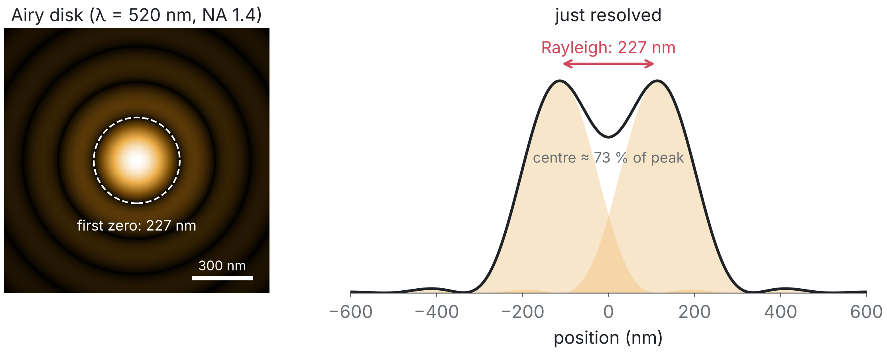{fig-alt="Airy disk for 520 nm and NA 1.4 with its first zero at 227 nm; profile of two point sources separated by the Rayleigh distance showing a dip."}
:::
:::

::: {.notes}
**7:30 → 8:30.** For a physicist this is a formula and a comfort zone. Abbe, Rayleigh, Airy disk. Numbers for GFP and an oil objective: about 190 to 230 nm. Keep that number in mind.
:::

## [Resolution, explained to]{.kicker .teal} …a biologist

::: {.columns}
::: {.column width="58%"}
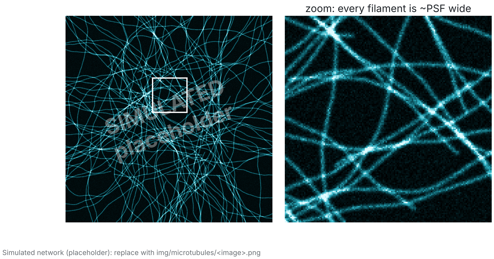{fig-alt="Fluorescence image of tubulin-stained BPAE cells (Fiji sample Fluorescent Cells) with a zoomed region showing filaments that are all about as wide as the PSF."}
:::
::: {.column width="42%"}
A microtubule is **~25 nm** wide.<br>
In your image it looks **~200 nm** wide.

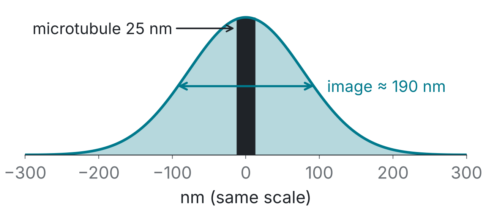{fig-alt="To scale: a 25 nm bar inside a 190 nm wide blurred profile."}
:::
:::

::: {.incremental .small style="margin-top:-10px"}
- Width measurements report the **PSF**, not the biology
- Filaments closer than ~200 nm **merge** into one (bundles, counts)
- Thin structures look **dimmer**
:::

::: {.notes}
**8:30 → 9:30.** For a biologist: start from a structure they know. Microtubules are 25 nm, yet every filament in a fluorescence image is about 8 times wider. So if you measure widths, you're measuring the microscope. If two filaments are closer than about 200 nm, they become one.
:::

## [Resolution, explained to]{.kicker .red} …a research software engineer

<video data-autoplay muted playsinline src="figures/out/microtubule_psf.mp4" style="width: 1040px; display: block; margin: -6px auto 0 auto;" poster="figures/out/microtubule_psf_final.png"></video>

::: {.fragment .center .small}
Three entry points → **one learning outcome**: *predict how the PSF inflates size and dilutes intensity*
:::

::: {.notes}
**9:30 → 11:00.** For a software engineer, the microscope runs gaussian_filter on reality. The kernel slides over the object, sums the light it collects, and writes a pixel. That's a convolution. And the 25 nm filament comes out about 185 nm wide: the same number as the physicist's formula and the biologist's image.
**Punchline:** three explanations, one learning outcome. The core fixes the outcome; bridges adapt the entry point.
:::

# A common core + electives {background-color="#F6F6F4"}

## The model: bridges → core → electives

::: {.model}
::: {.col}
::: {.box style="border-color:#2F909F"}
[**Biology**]{.teal}<br>bridge: optics, code
:::
::: {.box style="border-color:#EDAE49"}
[**Physics**]{.yellow}<br>bridge: biology, experimental design
:::
::: {.box style="border-color:#D66977"}
[**Computer science**]{.red}<br>bridge: optics, assays
:::
:::
::: {.arrow}
➜
:::
::: {.box .core}
**Common core**<br>
what *every* bioimage analyst masters, at an agreed depth
:::
::: {.arrow}
➜
:::
::: {.col}
::: {.small}
**Electives** → profiles
:::
[ML & validation]{.pill} [tracking]{.pill} [colocalisation]{.pill} [histology & colour]{.pill} [EM & correlative]{.pill} [big data & cloud]{.pill} [smart microscopy]{.pill} [deconvolution]{.pill} [3D visualisation]{.pill} [software dev]{.pill} [facility & consulting]{.pill}
:::
:::

<br>

::: {.fragment .center}
Like a degree: *ciclo básico* + *materias optativas*, countable in **ECTS**.
:::

::: {.notes}
**11:00 → 12:15.** The model: background-specific bridges, like the three resolution slides, lead into one shared core. After the core you choose electives that build a profile. It's how many universities structure degrees. NEUBIAS already expresses courses in ECTS, so the currency exists.
:::

## Candidate core: three pillars

::: {.cards .three}
::: {.card .grey .fill-grey .fragment}
[⬛ Digital image fundamentals]{.ct}
N-d arrays · data types & bit depth · display ≠ data · calibration & metadata · formats

[Digital image basics]{.pill .grey} [Data types]{.pill .grey} [Display settings]{.pill .grey} [Spatial calibration]{.pill .grey} [Image data formats]{.pill .grey}
:::
::: {.card .yellow .fill-yellow .fragment}
[🔺 Mechanics of image generation]{.ct}
PSF & resolution · sampling & Nyquist · noise · optical sectioning · artefacts

[Point spread function]{.pill .yellow} [Resolution]{.pill .yellow} [Image sampling]{.pill .yellow} [Illumination & shading]{.pill .yellow} [noise models: gap]{.placeholder}
:::
::: {.card .red .fill-red .fragment}
[🖥 Programming formalisms]{.ct}
variables & types · functions & loops · paths & I/O · environments · version control

[Variables]{.pill .red} [Functions]{.pill .red} [Loops]{.pill .red} [Strings & paths]{.pill .red} [Batch processing]{.pill .red} [version control: gap]{.placeholder}
:::
:::

[Pills = existing NEUBIAS modules; dashed = no module yet.]{.cite}

::: {.notes}
**12:15 → 14:15.** From the abstract, three candidate pillars. Each already maps to existing NEUBIAS modules (the pills). Some pieces have no module yet, such as noise models and version control. That's exactly the kind of gap a curriculum makes visible.
:::

## Is three enough? How deep?

::: {.columns}
::: {.column width="52%"}
**Candidate 4th / 5th pillars**

::: {.pills-big}
[Measurement & validation]{.pill}<br>
[Statistics & experimental design]{.pill .teal}<br>
[Biological context & assays]{.pill .teal}<br>
[Data management / FAIR]{.pill}<br>
[Image ethics & integrity]{.pill}
:::

::: {.fragment .small}
The three pillars come from the **physics** and **computing** islands.<br>
[None covers the **biology** island yet.]{.teal}
:::
:::
::: {.column width="48%" .fragment}
**Depth, not just breadth**

::: {.small}
The core means:<br>
*recognise when it matters, and know whom to ask.*

It does **not** mean "become a physicist".
:::
:::
:::

::: {.notes}
**14:15 → 15:00.** Open questions I don't want to answer alone. Is three enough? Notice that the three pillars come from the physics and computing islands: none covers the biology island (experimental design, biological context). And depth: the core is about recognising when something matters, not becoming an expert in everything. (Cut this slide if running late.)
:::

## A prototype to argue with: `bia_curriculum`

::: {.columns}
::: {.column width="68%"}
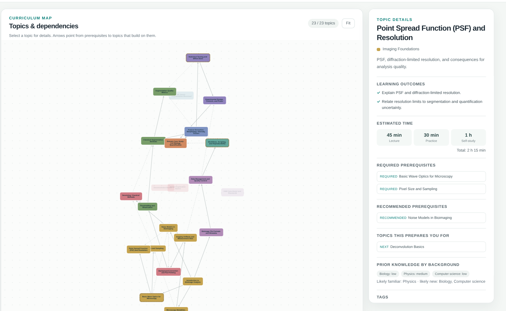{.shadow fig-alt="Screenshot of the bia_curriculum explorer: a topic dependency graph with the PSF and Resolution topic selected, showing learning outcomes, time estimates, prerequisites and prior knowledge by background."}
:::
::: {.column width="32%"}
::: {.small .tight}
**9** subjects · **23** topics<br>
prerequisite graph<br>
**3** background paths (≈ 39–43 h)<br>
prior knowledge **per background**<br>
YAML · CC BY 4.0 · PRs welcome
:::

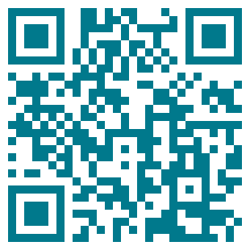{width="190" fig-alt="QR code to github.com/acorbat/bia_curriculum"}

[github.com/acorbat/bia_curriculum]{.xsmall}
:::
:::

::: {.notes}
**15:00 → 16:15.** To make this concrete I built a prototype: a dependency graph of topics, each annotated with learning outcomes, time, and prior knowledge by background. It has paths for biologists, physicists and CS people, with bridge topics marked. It's a draft and the pillars are not fully covered yet, which is deliberate: it's something to argue with.
:::

## Electives: complete your profile

<br>

::: {.center .pills-big}
[ML / DL & validation]{.pill .red} [Image restoration & deconvolution]{.pill .yellow} [Tracking]{.pill .teal}
[Colocalisation]{.pill .teal} [Histology & colour spaces]{.pill .teal} [EM & correlative]{.pill .yellow}
[Big data · OME-Zarr · cloud]{.pill .red} [Smart microscopy]{.pill .yellow} [3D visualisation]{.pill}
[Tool & software development]{.pill .red} [Facility & consulting skills]{.pill} [Teaching & training]{.pill}
:::

<br>

::: {.center .muted}
Many already have modules; many don't.<br>A curriculum tells us **which to build next**.
:::

::: {.notes}
**16:15 → 16:40.** Quick: these are examples of electives. You'd pick a few depending on your job. This is a list to refine together, not a final answer.
:::

# Kickstarting a Working Group {background-color="#F6F6F4"}

## Proposal: a GloBIAS Curriculum Working Group

::: {.big}
**Mission:** define a community-agreed **common core** and an **elective map** for bioimage analysts, built on existing open resources.
:::

::: {.cards .three}
::: {.card .grey .fragment}
[Scope]{.ct}
Baseline topics & depth · elective framework · bridges per background · map to existing modules
:::
::: {.card .grey .fragment}
[Not in scope]{.ct}
Re-writing modules that already exist · certification (for now)
:::
::: {.card .teal .fill-teal .fragment}
[Principles]{.ct}
Open · tool-agnostic · CC BY · background-aware · global
:::
:::

::: {.notes}
**16:40 → 17:45.** So here's the ask. A GloBIAS working group with a narrow mission: define the core and the elective map. We won't rewrite modules; we connect and fill gaps. It should be open, tool-agnostic and global, including regions like Latin America where formal BIA training is scarce.
:::

## First deliverables

::: {.timeline}
::: {.m}
::: {.dot}
M0
:::
**Kick-off**<br>at this meeting<br><span class="muted">conversations · first call</span>
:::
::: {.m}
::: {.dot}
M3
:::
**Community survey**<br>on the core<br><span class="muted">what is essential? how deep?</span>
:::
::: {.m}
::: {.dot}
M6
:::
**Baseline v0.1**<br>mapped to modules<br><span class="muted">gaps made visible</span>
:::
::: {.m}
::: {.dot}
M12
:::
**Electives & bridges**<br>mapped to modules<br><span class="muted">a first full map</span>
:::
:::

<br><br>

::: {.center .muted .small}
M = months after kick-off. A proposed timeline, to be agreed together.
:::

::: {.notes}
**17:45 → 18:45.** A concrete first year: kick off now; survey the community on the core in three months; a v0.1 baseline mapped to existing modules at six months; and electives and bridge modules mapped at twelve. (M = months after kick-off.)
:::

## Join us

::: {.columns}
::: {.column width="62%"}
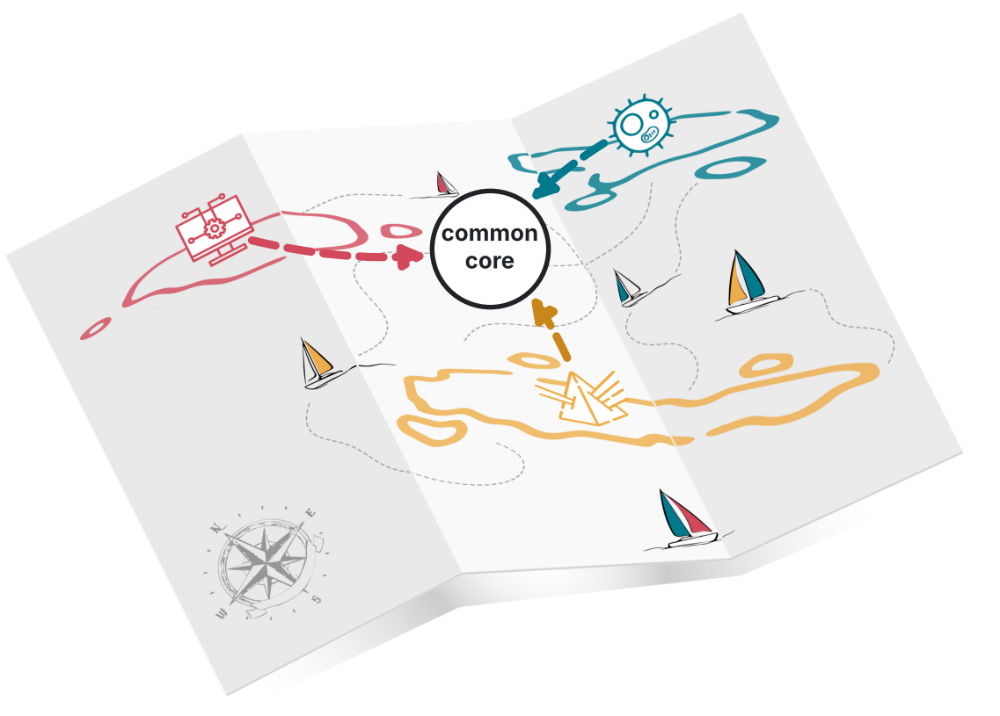{fig-alt="The archipelago map with dashed routes from all three islands converging on a common core."}
:::
::: {.column width="38%" .join}
<br><br>

**Help draw the chart.**

Find me during the meeting<br>to discuss further,

or contact me later.

[Contact details on the next slide.]{.small .muted}
:::
:::

::: {.notes}
**18:45 → 19:30.** If you want to help draw this chart, come and find me during the meeting, or contact me later. Everyone is welcome, from any island. All three routes, one common core.
:::

## Thank you!

::: {.columns}
::: {.column width="58%"}
**Acknowledgements**

[For their support]{.ack-h}

<div class="logo-wall">


</div>

[For the discussions]{.ack-h}

<div class="logo-wall">


</div>

[Built on the NEUBIAS training resources (Tischer et al., 2026) and their authors' work.]{.xsmall .muted}
:::
::: {.column width="42%"}
**Let's discuss**

::: {.small}
1. What is missing from the core?
2. How deep is deep enough?
3. Who should own and maintain it?
:::

**Contact**

::: {.contact-list}
[email]{.k} acorbat@df.uba.ar<br>
[Bluesky]{.k} [@acorbat.bsky.social](https://bsky.app/profile/acorbat.bsky.social)<br>
[LinkedIn]{.k} [in/agustin-andres-corbat](https://www.linkedin.com/in/agustin-andres-corbat/)
:::
:::
:::

::: {.notes}
**19:30 → 20:00.** Thanks to FUNDACEN, GloBIAS and the Physics Department for their support, and to the Centro de Microscopías Avanzadas and LABI for the discussions that shaped this proposal. This builds on the NEUBIAS training resources. Three questions to start the discussion.
:::

# Backup {.unlisted background-color="#F6F6F4"}

## B1 · Core pillars → existing material {.smaller}

| Pillar | NEUBIAS modules | `bia_curriculum` topics |
|---|---|---|
| Digital image fundamentals | Digital image basics · Data types · Display settings · Spatial calibration · Multichannel · N-dimensional images · Image data formats · OME-TIFF | File formats & metadata · OME data model *(no dedicated "digital image" topic yet)* |
| Image generation | Image sampling · Optimal sampling · Resolution · Point spread function · Optical sectioning · Spherical aberrations · Illumination & shading · Thick samples · Sample-prep artefacts | Wave optics · Pixel size & sampling · PSF & resolution · Noise models · Artefacts & bias · Deconvolution |
| Programming formalisms | Running/recording a script · Variables · Strings & paths · Functions · Loops · Input parameters · Output saving · Batch processing · Coding with LLMs | Workflows, scripting & reproducibility *(single topic)* |

## B2 · A topic in `bia_curriculum`

```yaml
id: TOP-psf-and-resolution
title: Point Spread Function (PSF) and Resolution
subject_id: SUBJ-imaging-foundations
learning_outcomes:
  - Explain PSF and diffraction-limited resolution.
  - Relate resolution limits to segmentation and quantification uncertainty.
prerequisites:
  required: [TOP-basic-wave-optics, TOP-pixel-size-and-sampling]
  recommended: [TOP-noise-models]
estimated_time: {lecture_minutes: 45, practical_minutes: 30, self_study_minutes: 60}
audience_prior_knowledge: {biology: low, physics: medium, computer_science: low}
```

## B3 · Background paths in `bia_curriculum`

| Path | Topics | Total time | Bridge topics |
|---|---|---|---|
| BIA for Biologists | 19 | ≈ 39 h | wave optics · statistics · scripting |
| BIA for Physicists | 20 | ≈ 41 h | experimental design |
| BIA for Computer Scientists | 21 | ≈ 43 h | wave optics · microscopy modalities · experimental design |

## B4 · NEUBIAS example courses

| Course | Modules | Hours | ECTS |
|---|---|---|---|
| Bioimage Inspection | 8 | 6 | 0.4 |
| Bioimage Analysis | 13 | 9 | 0.6 |
| Advanced Topics in Bioimage Analysis | 6 | 4.5 | 0.3 |
| Image Formation and Imaging Artefacts | 12 | 9 | 0.6 |
| Image Data Formats | 5 | 3 | 0.2 |
| Bioimage Batch Analysis | 6 | 3.75 | 0.25 |
| ImageJ Macro | 8 | 6 | 0.4 |

[1 ECTS = 30 h workload, including self-study. Source: neubias.github.io/training-resources]{.cite}

## B5 · References {.smaller}

- Tischer C, Politi AZ, *et al.* (2026). Modular training resources for bioimage analysis. *J. Microsc.* 304:3–14. doi:10.1111/jmi.70133
- NEUBIAS Bioimage Analysis Training Resources. neubias.github.io/training-resources (CC BY 4.0)
- Bankhead P. *Introduction to Bioimage Analysis.* bioimagebook.github.io
- Meysenburg M, *et al.* *Image Processing with Python* (The Carpentries). datacarpentry.github.io/image-processing
- Seitz A, Guiet R, Burri O, Chiaruttini N. EPFLx *Image Processing and Analysis for Life Scientists* (edX)
- Haase R. *BioImage Analysis* lecture series (YouTube) · ZIDAS · NEUBIAS Academy
- Zhang B, Zerubia J, Olivo-Marin J-C (2007). Gaussian approximations of fluorescence microscope PSF models. *Appl. Opt.* 46:1819–1829
- Microtubule image: *Fluorescent Cells* (BPAE cells, anti-tubulin channel), ImageJ/Fiji sample image, public domain
- Curriculum prototype: github.com/acorbat/bia_curriculum (CC BY 4.0)
